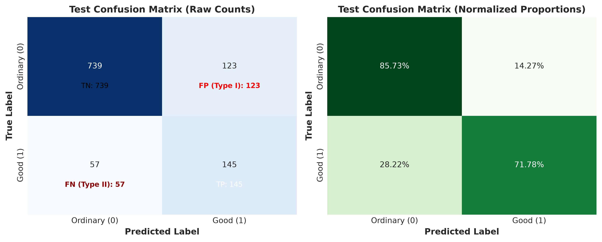
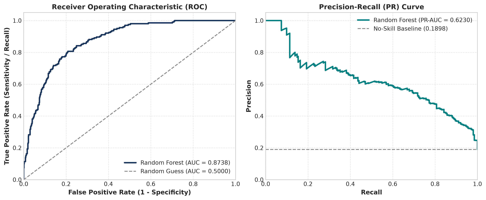
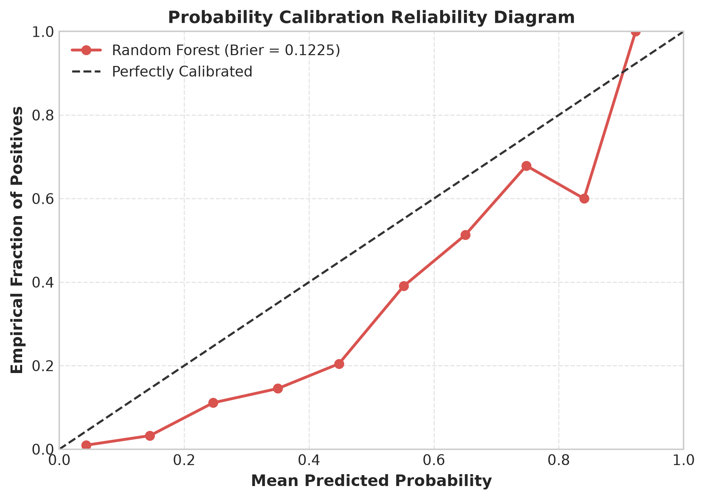
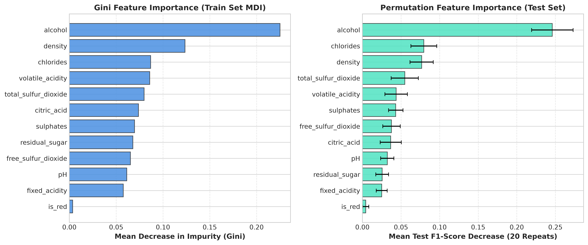
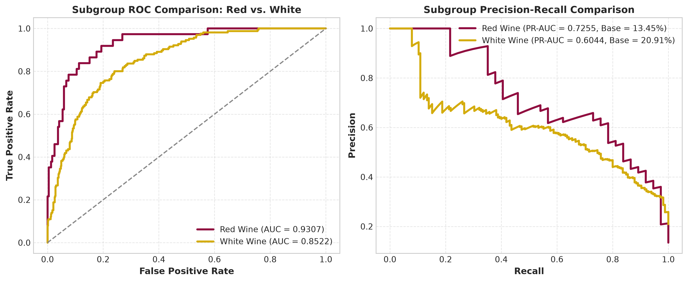

# Model Analysis

We evaluated our final Random Forest model on the 1,064 unseen wines in `data/test.csv`. This section examines its performance on new data, the trade-offs between different types of errors, diagnostic curves, which chemical features drove the predictions, and how the model performed on red versus white wines.

---

## Test Set Performance

Table 8 summarizes the final performance metrics evaluated on the 1,064 held-out test observations.

**Table 8.** Final Random Forest Evaluation on Held-Out Test Dataset (N = 1,064)

| Performance Metric | Test Score | Operational Interpretation |
|---|---|---|
| **Accuracy** | **83.08%** (0.8308) | Correctly classifies 884 of 1,064 total test wines |
| **Precision** | **54.10%** (0.5410) | 145 of the 268 wines flagged as good are truly good |
| **Recall (Sensitivity)** | **71.78%** (0.7178) | Finds 145 of the 202 true good test wines |
| **Specificity** | **85.73%** (0.8573) | Correctly labels 739 of 862 ordinary wines |
| **F1-Score** | **0.6170** | Harmonic balance between precision and recall |
| **ROC-AUC** | **0.8738** | Strong ability to rank good wines above ordinary wines across thresholds |
| **PR-AUC (Average Precision)** | **0.6230** | Substantially outperforms the 0.1898 baseline of random guessing |
| **Brier Score Loss** | **0.1225** | Lower than the 0.1538 baseline of predicting the 19% base rate; see calibration note below |

Table 9 presents the detailed classification report for both target classes.

**Table 9.** Test Classification Report by Class

| Class Label | Support (N) | Precision | Recall | F1-Score |
|---|---|---|---|---|
| **Ordinary Wine (`is_good = 0`)** | 862 (81.02%) | 0.9284 | 0.8573 | 0.8914 |
| **High-Quality Wine (`is_good = 1`)** | 202 (18.98%) | 0.5410 | 0.7178 | 0.6170 |
| **Macro Average** | 1,064 | 0.7347 | 0.7876 | 0.7542 |
| **Weighted Average** | 1,064 | 0.8549 | 0.8308 | 0.8393 |

The test set results confirm that the model generalizes well to unseen data. The test F1-score (0.6170) and test ROC-AUC (0.8738) slightly exceed the cross-validation estimates (0.5599 and 0.8492, respectively), confirming that the model did not overfit to the training data.

---

## Confusion Matrix and Decision Trade-offs

Figure 8 displays the raw count and normalized confusion matrices on the test dataset.

Out of 1,064 test evaluations:
- **True Negatives (TN):** 739 samples (69.45% of total, 85.73% of ordinary wines).
- **True Positives (TP):** 145 samples (13.63% of total, 71.78% of good wines).
- **False Positives (FP: Type I Error):** 123 samples (11.56% of total, 14.27% of ordinary wines).
- **False Negatives (FN: Type II Error):** 57 samples (5.36% of total, 28.22% of good wines).

### Practical Implications of Errors:

1. **False Positives (123 wines):** An ordinary wine is labeled good. In a winery, this wine might be routed to a premium bottling line. The risk is putting an average wine on store shelves under a reserve label, which damages customer trust and brand reputation. Using the model as a preliminary filter--where flagged wines are tasted by experts before bottling--mitigates this risk.
2. **False Negatives (57 wines):** A good wine is labeled ordinary and sold as bulk table wine. The risk is lost revenue from missing a premium product. Balanced class weighting keeps false negatives low (only 5.36% of all test wines), catching over 71% of all premium lots.

---

## ROC, Precision-Recall, and Calibration Curves

Figure 9 illustrates the Receiver Operating Characteristic (ROC) curve alongside the Precision-Recall (PR) curve for the held-out test dataset.

### Key Observations:
- **ROC Trajectory (AUC = 0.8738):** The ROC curve climbs steeply at low false positive rates, reaching over 70% recall while keeping the false positive rate below 15%. This demonstrates strong discriminative ability.
- **Precision-Recall Curve (PR-AUC = 0.6230):** The horizontal dashed line at 0.1898 represents random guessing. The model stays well above this baseline across the entire range of recall.
- **Adjusting the Decision Threshold:** At the default 0.50 cutoff, the model achieves 54.10% precision and 71.78% recall (F1 = 0.6170). A winery can adjust this threshold depending on its commercial strategy:
  - *Protecting the Brand (High Precision):* Raising the threshold to 0.65 increases precision to 62.86% (at 43.56% recall). Setting it to 0.70 gives 68.93% precision (at 35.15% recall), and 0.75 gives 73.68% precision (at 27.72% recall), ensuring that almost all wines bottled as reserve are genuinely high quality.
  - *Finding More Good Wine (High Recall):* Lowering the threshold to 0.40 captures 80.69% of good wines (at 45.79% precision). Setting it to 0.35 captures 85.15% of good wines (at 41.95% precision) for expert review.

Figure 10 displays the probability calibration curve (reliability diagram).

The calibration curve shows an upward shift: across the lower and middle ranges, the model's predicted probabilities are higher than the actual rates of good wines. For example, wines scored around 0.45 are actually good only 20.45% of the time. This shift is an expected consequence of using `class_weight='balanced'`, which puts a 2.64 times penalty on minority class errors during tree splitting. While this weighting helps the model separate the classes (yielding an ROC-AUC of 0.8738 and an F1-score of 0.6170), the raw probabilities reflect relative rankings rather than exact probabilities. If exact probabilities are needed, the model should be recalibrated using Platt scaling or isotonic regression. Even with this shift, the Brier score loss is 0.1225, which improves upon the 0.1538 baseline of predicting the overall 19% base rate.

---

## Feature Importance

To understand the chemical drivers governing wine quality classification, we analyzed feature importance using two distinct analytical methods:
1. **Gini Impurity Importance (Mean Decrease in Impurity, MDI):** Total impurity reduction across all 300 bagged trees during training.
2. **Permutation Feature Importance:** Model-agnostic drop in test F1-score when each feature is randomly shuffled across 20 iterations on `data/test.csv`.

Table 10 compares the rankings from both methodologies.

**Table 10.** Physicochemical Feature Importance Comparison

| Feature Name | Permutation Mean (F1 Drop) | Permutation Std | Gini Impurity (MDI) | Physical/Chemical Mechanism |
|---|---|---|---|---|
| **Alcohol** | **0.2461** | 0.0268 | **0.2251** | Ethanol content: body, perceived sweetness, aromatic volatility |
| **Chlorides** | 0.0796 | 0.0167 | 0.0869 | Salt content: mineral mouthfeel; excess imparts saltiness and bitterness |
| **Density** | 0.0768 | 0.0151 | 0.1235 | Inversely related to alcohol and sugar: overall mouthfeel and body |
| **Total Sulfur Dioxide** | 0.0549 | 0.0177 | 0.0799 | Preservative: antioxidant/antimicrobial; excess dulls fruit flavors |
| **Volatile Acidity** | 0.0437 | 0.0146 | 0.0858 | Acetic acid: vinegar fault; lower levels required for clean sensory profile |
| **Sulphates** | 0.0432 | 0.0093 | 0.0696 | Potassium sulphate: antimicrobial synergy, fruit freshness enhancer |
| **Free Sulfur Dioxide** | 0.0377 | 0.0113 | 0.0652 | Active unbound preservative protecting wine from oxidation |
| **Citric Acid** | 0.0367 | 0.0137 | 0.0738 | Minor organic acid: provides crispness and fresh citrus notes |
| **pH** | 0.0323 | 0.0085 | 0.0613 | Acidity buffer: microbial stability and perception of tartness |
| **Residual Sugar** | 0.0256 | 0.0082 | 0.0678 | Unfermented sugar: balance against high acidity in Vinho Verde |
| **Fixed Acidity** | 0.0250 | 0.0072 | 0.0576 | Tartaric and malic acids: foundational crisp structural acidity |
| **is_red** | 0.0044 | 0.0040 | 0.0035 | Variety indicator: secondary after direct chemical measurements |

Figure 11 illustrates the comparative importance profiles.

### Key Chemical Insights:
1. **Alcohol is the strongest predictor:** Shuffling alcohol values on the test set drops the model's F1-score by 0.2461 (from 0.6170 down to ~0.3709). Gini importance on the training set confirms this finding (0.2251). In the cool climate of Vinho Verde, higher natural alcohol indicates fully ripe grapes with concentrated flavors, balanced acidity, and proper maturity.
2. **Chlorides and density provide structural boundaries:** Chlorides (salt content) and density are the second and third most important features under permutation. Too much chloride adds an unpleasant salty or soapy taste that judges penalize. Density reflects the balance of sugar and alcohol, acting as an indicator of body and extraction.
3. **Acidity and cleanliness:** Volatile acidity (acetic acid) is a clear negative marker associated with vinegar spoilage, and good wines consistently have lower levels. Sulphates and sulfur dioxide protect against oxidation and bacterial spoilage, keeping fruit aromas fresh.
4. **Wine type (`is_red`) adds little:** Once individual chemical measurements (such as acidity, density, and sulfur levels) are known, knowing whether a wine is red or white provides almost no additional predictive power (permutation drop of only 0.0044).

---

## Red vs. White Wine Performance

To evaluate whether the model functions equally well across wine varieties, we disaggregated test set performance by wine type.

**Table 11.** Subgroup Disaggregation on Test Dataset

| Wine Variety | Samples (N) | Good Wines (N) | Prevalence | Accuracy | Precision | Recall | F1-Score | ROC-AUC | PR-AUC |
|---|---|---|---|---|---|---|---|---|---|
| **Red Wine** | 275 | 37 | 13.45% | **90.18%** | **60.42%** | **78.38%** | **0.6824** | **0.9307** | **0.7255** |
| **White Wine** | 789 | 165 | 20.91% | 80.61% | 52.73% | 70.30% | 0.6026 | 0.8522 | 0.6044 |

Figure 12 shows the disaggregated ROC and PR curves for red and white wines.

### Subgroup Findings:
- **Red Wines:** The model performed particularly well on red wines: 90.18% accuracy, 78.38% recall, 0.6824 F1-score, and an ROC-AUC of 0.9307 (with PR-AUC of 0.7255 against a 13.45% base rate). In red wines, spoilage markers like volatile acidity and preservatives like sulphates create sharp distinctions. However, the test set had only 37 good red wines, so this result is based on a smaller sample.
- **White Wines:** White wines had an ROC-AUC of 0.8522 and an F1-score of 0.6026. White wines have wider variation in residual sugar and acidity (from bone-dry to sweet), leading to more overlap between ordinary and good wines.
- **Takeaway:** The model is effective on both styles, with especially clean separation on red wines.

---

## Model Validity and Overfitting Check

To verify algorithmic stability and confirm that the model did not memorize training artifacts, we compared performance across training, 10-fold cross-validation, and held-out testing partitions.

**Table 12.** Performance Comparison across Training, Cross-Validation, and Test Sets

| Metric | Training Set (Fit, N = 4,256) | 10-Fold CV Validation (Mean +/- Std) | Held-Out Test Set (Unseen, N = 1,064) |
|---|---|---|---|
| **Accuracy** | 97.46% | 80.50% +/- 1.70% | 83.08% |
| **F1-Score** | 0.9372 | 0.5599 +/- 0.0338 | 0.6170 |
| **ROC-AUC** | 0.9991 | 0.8492 +/- 0.0155 | 0.8738 |
| **Precision** | 0.8924 | 0.4908 +/- 0.0352 | 0.5410 |
| **Recall** | 0.9864 | 0.6543 +/- 0.0501 | 0.7178 |

### Findings:
1. **Regularization worked:** Random forest models naturally achieve very high training scores (97.46% accuracy) because individual trees can grow deep on bootstrap samples. However, cross-validation scores remained steady with low standard deviations across all 10 folds (F1 = 0.5599 +/- 0.0338, ROC-AUC = 0.8492 +/- 0.0155).
2. **Generalization to unseen data:** The test set scores (F1 = 0.6170, ROC-AUC = 0.8738) closely match the cross-validation estimates. This confirms that our hyperparameter constraints (`max_depth = 15, min_samples_leaf = 2`) prevented the ensemble from memorizing noise.

---

## Limitations

While the Random Forest classifier demonstrates strong empirical performance, practical deployment in commercial viticulture must account for several structural limitations:

1. **Regional viticultural specificity:** All samples originate from the Vinho Verde region in northwest Portugal. Vinho Verde is characterized by a cool, humid Atlantic climate producing wines with high natural acidity, lower alcohol levels, and distinctive carbonation. The physicochemical boundaries learned by this model may not generalize to warmer viticultural regions (such as Napa Valley, Rioja, or Barossa Valley) where baseline alcohol, sugar, and tannin profiles differ markedly.
2. **Subjectivity in sensory quality ratings:** The ground-truth quality score represents the median rating from at least three sensory experts on a 0 to 10 scale. Expert wine tasting involves subjective palate differences, fatigue during lengthy tasting flights, and ambient temperature sensitivity. This sensory variance introduces irreducible label noise near the decision boundary (qualities 6 vs. 7).
3. **Absence of commercial and viticultural variables:** The dataset contains purely post-fermentation laboratory chemistry. It omits critical factors that heavily drive commercial market pricing, including:
   - Specific grape cultivar (e.g., Alvarinho, Loureiro, Vinhao).
   - Vintage year and meteorological growing season conditions.
   - Oak barrel maturation duration and toast profiles.
   - Phenolic and anthocyanin compounds (tannins, color pigments).
   - Brand equity, packaging, and retail distribution channels.
